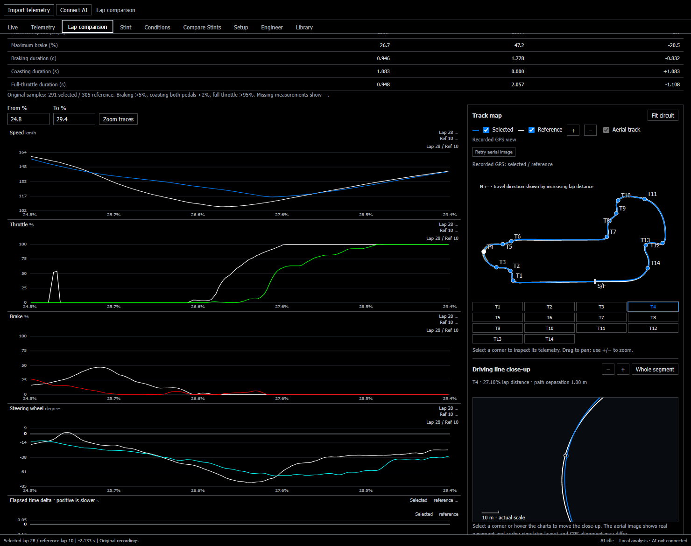
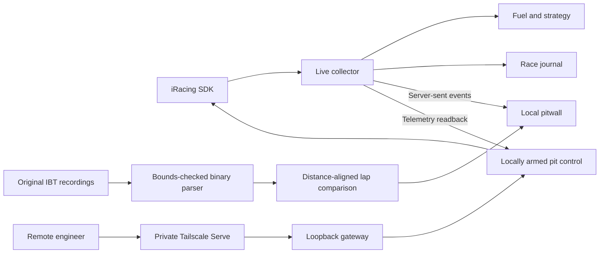

[](https://github.com/pothamsettivarun/race-engineering-portfolio/actions/workflows/tests.yml)

This portfolio brings together a local race engineering workstation and its use in iRacing endurance setup development. During a race, the workstation shows multiclass timing, fuel range, and the next viable pit window. After a stint, it compares two laps corner by corner from the original telemetry.

**[Indy 8 Hour case study](examples/indy-8-hour/README.md) · [Run the workstation](#run-the-workstation) · [How it works](#how-it-works) · [Simulator validation](REMOTE_ACCEPTANCE.md)**

## Indianapolis 8 Hour setup development

I used the workstation to compare a baseline and five setup revisions for the Corvette Z06 GT3.R at Indianapolis Road Course. The best recorded lap went from **1:25.400 to 1:23.267**, with changes in temperature and fuel across the development sessions. In a closer comparison at **43.89 °C** track temperature and within **0.012 L** of starting fuel, v1 was **0.533 s** quicker than the baseline.



[See the setup changes, matched-lap screenshot, and measured CSV sample](examples/indy-8-hour/README.md).

## Run the workstation

Install Python 3.11 or newer. On Windows, clone the repo and double-click **Start Stint.cmd**, or run these PowerShell commands.

```powershell
git clone https://github.com/pothamsettivarun/race-engineering-portfolio.git
cd race-engineering-portfolio
python -m venv .venv
.\.venv\Scripts\python.exe -m pip install -r requirements.txt
.\.venv\Scripts\python.exe server.py --open
```

On macOS or Linux, use `python3` to create the environment and `.venv/bin/python` for the last two commands. Stint opens at [localhost:8765](http://127.0.0.1:8765). Import a completed iRacing `.ibt` under **Import telemetry**, or open **Live** with iRacing running on Windows. Follow the [driver and engineer guide](docs/GUIDE.md) for telemetry logging, race strategy, and private remote access.

## What you can do

| Workflow | What Stint does |
| --- | --- |
| **Monitor a race** | Samples the iRacing SDK at 20 Hz and streams browser snapshots at 10 Hz. Follow class positions, lap and pit history, player traces, and fuel from eligible laps. |
| **Plan a stint** | Compare stop laps, fuel loads, service time, and driver schedules against reserve and stint constraints. The model uses constant-pace and constant-consumption projections. |
| **Compare two laps** | Align native samples by lap distance, rank time gained or lost by segment, and inspect pedal traces, corner speeds, and GPS driving lines. The segment deltas reconcile to the total lap delta. |
| **Work with a remote engineer** | Give a teammate private access via Tailscale Serve. The driver enables pit control locally, and Stint checks SDK telemetry to determine whether the requested selections took effect. |

## How it works



- **Separate source data from display data.** Originals are stored by SHA-256. Timing and extrema use native samples while the browser receives reduced traces. Invalid gaps and backward progress prevent alignment.
- **Keep the live state bounded.** In-memory traces and event buffers have fixed limits. A local journal and atomic checkpoints support session recovery and mark coverage gaps after a restart.
- **Confirm commands against observed state.** Pit changes require a current driver, fresh data, and local authorization. Later SDK observations distinguish confirmed, partial, and unconfirmed results. Driver and session changes disarm control.

Python and NumPy handle analysis and strategy. A local Python HTTP server serves a vanilla JavaScript interface with SVG and Canvas charts.

Workspace state and recordings are stored under `data/`, which Git ignores. The engineering worksheet can optionally use Codex or the OpenAI API with selected run evidence and library excerpts. See the [data-flow guide](docs/GUIDE.md#ai-and-your-engineering-library) and [source provenance](SOURCES.md).

## Verification

```sh
python -m unittest discover -s tests -v
python examples/indy-8-hour/summarize.py
```

A [two-PC iRacing acceptance test](REMOTE_ACCEPTANCE.md) confirmed remote fuel and tire selections against simulator readback. The validation notes also document the eight-hour endurance load check and the 64-car workload.
