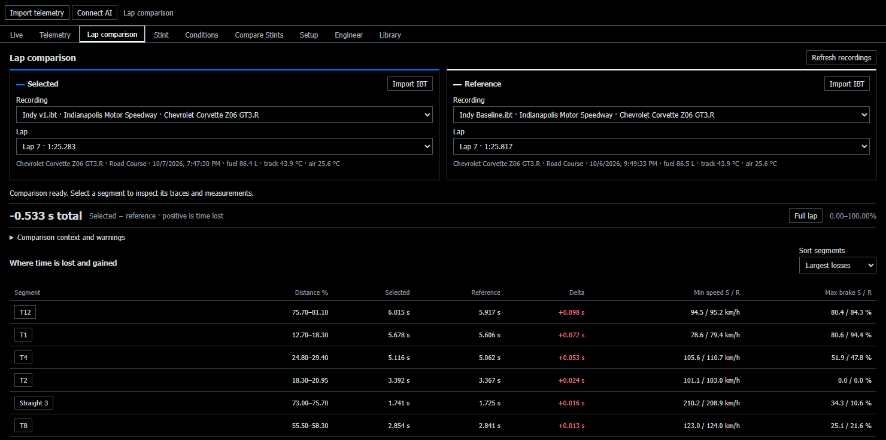
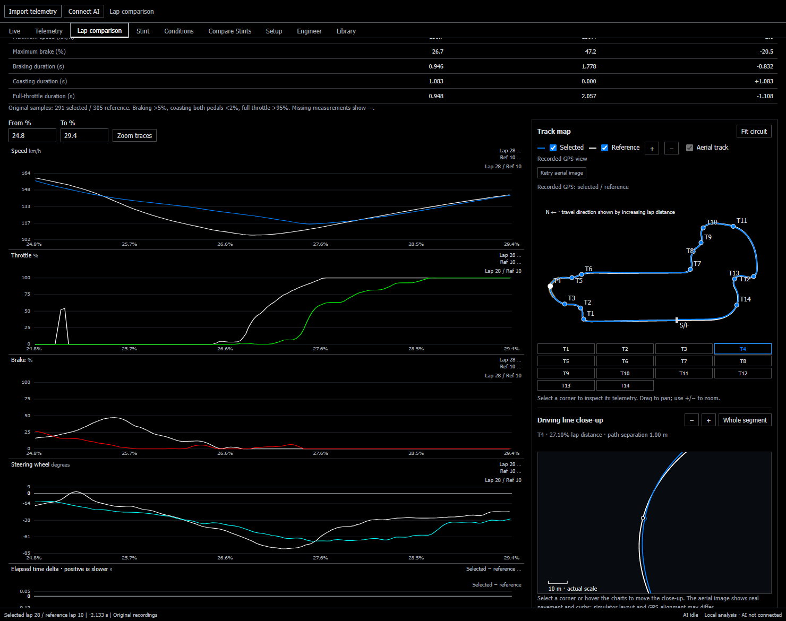

# Indianapolis 8 Hour setup development

**Chevrolet Corvette Z06 GT3.R · Indianapolis Road Course · October 2026**

The baseline pushed wide mid-corner and on throttle. Across five revisions, we adjusted roll stiffness, damping, differential preload, rear wing angle, and ABS. Stint retained the setup snapshots, filtered laps with incidents or other exclusions, and aligned the original samples by lap distance to show where the pace changed.

| Setup | Change recorded in the garage snapshot | Eligible laps | Median lap |
| --- | --- | ---: | ---: |
| Baseline | Starting configuration | 13 | 1:26.067 |
| v1 | Front anti-roll bar blade 5 → 6 and rear low-speed compression 5 → 6 clicks | 9 | 1:25.417 |
| v2 | Differential preload 120 → 115 N·m | 11 | 1:25.283 |
| v3 | Rear wing 9.5° → 8.5° | 7 | 1:25.167 |
| v4 | Differential preload 115 → 125 N·m and rear anti-roll bar blade 2 → 1 | 16 | 1:24.767 |
| v5 | ABS setting 3 → 2 | 26 | 1:23.867 |

### Comparison at similar fuel and track temperature

Lap 7 from each session started at **86.455 L** for the baseline and **86.444 L** for v1. Both recorded **43.89 °C** track temperature. The v1 lap was **0.533 s** faster. Tire state, driving variation, and the two simultaneous setup changes still limit what this pair can establish about either adjustment.

### Where the final validation lap gained time

The best clean lap went from **1:25.400** on the baseline to **1:23.267** on v5. Turns 4, 9, and 13 showed the largest corner-zone gains at **0.224 s**, **0.216 s**, and **0.205 s** respectively. The baseline session recorded about **43.9 °C** track temperature, compared with **21.1–22.8 °C** in the v5 validation. Fuel loads also differed. The 2.133-second gap describes the observed laps under those conditions.

### Measured sample

| File | Contents |
| --- | --- |
| [setup-laps.csv](setup-laps.csv) | 140 lap records across the six sessions. Includes timing, eligibility, fuel at the lap start, and lap-average track temperature where measured. Empty cells mean unavailable. |
| [best-lap-segments.csv](best-lap-segments.csv) | 17 corner and straight segments partitioning the lap, with lap-distance boundaries, elapsed time, minimum speed, and maximum brake input. Negative `v5_minus_baseline_s` means v5 was quicker. |

These tables come from Stint's analysis of retained iRacing recordings. The public extract contains measured fields and setup labels. Original IBTs, driver identifiers, and private debriefs remain in the local workspace. The screenshots show the same recorded laps in Stint with shortened filenames.

From the repo root, run `python examples/indy-8-hour/summarize.py` to reproduce the lap counts and medians, check the closer-matched pair, and reconcile the segment deltas to the best-lap difference.
